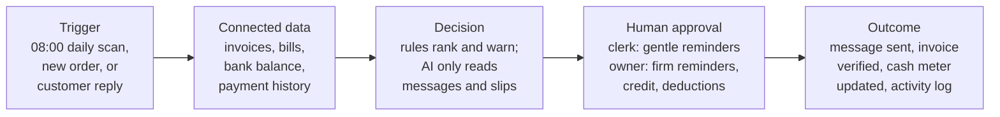
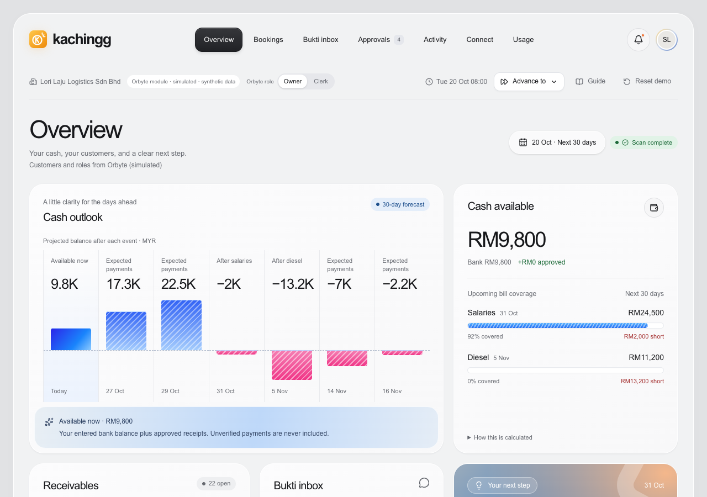
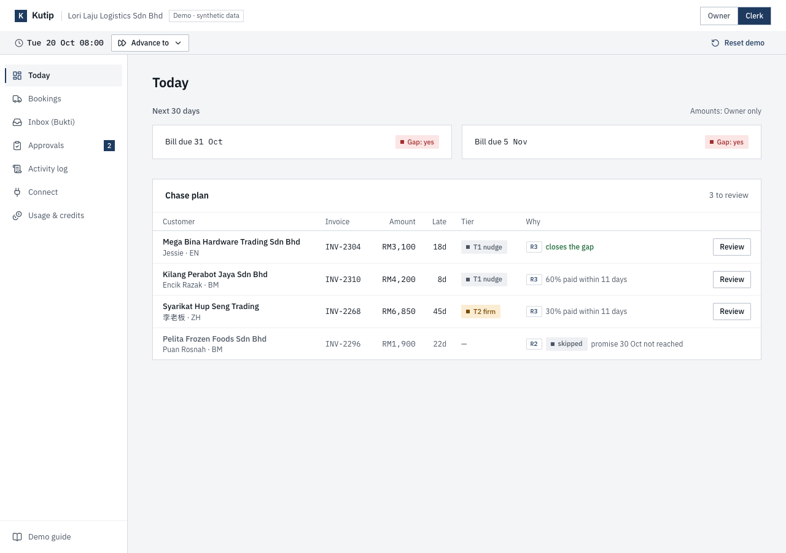
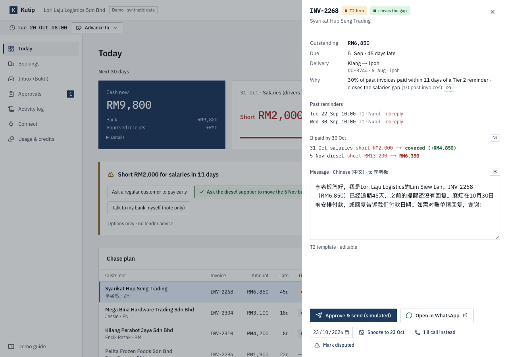
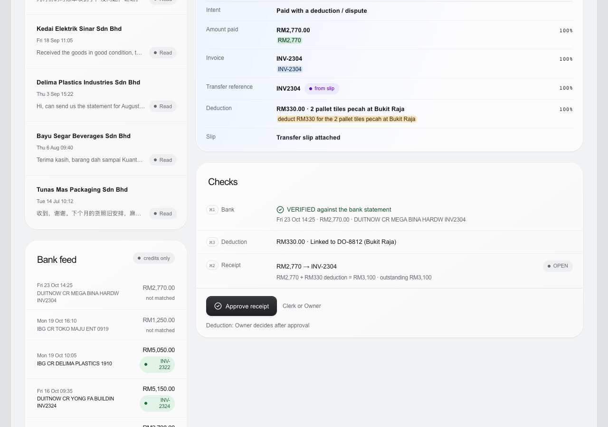

# Kachingg

**Never be surprised on payroll day, and stop giving credit to customers who don't pay.**

Kachingg is a cash-collection assistant for Malaysian micro and small businesses, built for the Orbyte business hub. It warns the owner before cash runs short, stops new credit to customers who already pay late, tells the team who to chase first, and uses AI to check customers' "dah bank in boss" messages against the bank statement.

Formerly called Kutip during research; the research notes in `docs/research/` and `docs/idea/` keep the old name.

> XMUM Hackathon · Domain 2: *Orbyte Smart SME Challenge — Less Busywork, Better Business* · sponsored by Alpha Red
>
> **Live demo:** https://kachingg-app.vercel.app · open **Guide** at the top for the 3-minute walk-through. All data is synthetic.

---

## The problem

Small Malaysian businesses that sell to other businesses usually sell **on credit**. A haulage firm delivers three lorry-loads of tiles for a hardware wholesaler, and the wholesaler says *"I'll pay in 30 days."*

The wholesaler pays after 60 days, or 90. Meanwhile the haulier must pay **salary on the 31st**, plus rent and its own suppliers. The money it has earned is stuck in other people's pockets.

So the owner spends evenings on WhatsApp asking *"boss, can pay already?"*, and:

- finds out on payroll day that there isn't enough cash;
- keeps giving more goods on credit to the same customers who pay late;
- chases customers at random, from memory;
- matches "dah bank in" screenshots to the bank app by hand, and sometimes chases a customer who already paid.

SME payment delays in Malaysia average **64 days**, and **76 days** in transport and logistics ([Experian, 2025](https://www.experian.com.my/2025/05/21/experian-malaysias-state-of-credit-2025-reveals-sme-resilience-but-cash-flow-strains-persist/)).

## The idea

A customer can always choose not to pay, and no app can change that. So Kachingg focuses on what the owner **can** control:

| | Feature | What it does |
|---|---|---|
| 1 | **Early warning** | Every morning it compares cash in the bank plus expected payments with the bills due soon. It warns the owner **10+ days before** a shortfall, while there is still time to act. |
| 2 | **Credit check** | When a customer who is already 30+ days late orders again on credit, Kachingg holds the order until the owner decides: give credit, ask for a deposit, cash on delivery, or call first. |
| 3 | **Chase plan** | It ranks overdue invoices by how much each one closes the shortfall, and prepares WhatsApp reminders in the customer's language (BM, English, 中文). A clerk sends gentle ones; firm ones need the owner. |
| 4 | **Bukti** *(the AI part)* | AI reads customer replies and payment slips. The invoice is marked paid **only if the money is actually in the bank statement**. Anything unclear goes to a person. |

*Kachingg* is the sound of the till when you get paid. *Bukti* means "proof".

## How it works



- **Rules make every decision**, and every decision shows the rule behind it.
- **AI is used in one place only**: reading messy replies like *"dah bank in boss"* or *"下礼拜五才过数"* ("can pay next Friday").
- **AI never decides anything about money.** Nothing is marked paid without a matching bank line.
- **People approve every consequential action**, and everything goes into an append-only activity log.

## See it in action

*All names and numbers are fictional.* The demo company is **Lori Laju Logistics**, a 12-person haulage firm in Klang with 6 lorries. Transport has the longest SME payment delays in Malaysia (76 days on average), and per-trip invoices mean many payment slips.

On Tuesday at 08:00, Kachingg spots a salary shortfall 11 days ahead:

```text
┌────────────────────────────────────────────────────────────────────┐
│ EARLY WARNING · 31 Oct salaries                  Owner only        │
├────────────────────────────────────────────────────────────────────┤
│ Short RM2,000 in 11 days, if nobody else pays                      │
├────────────────────────────────────────────────────────────────────┤
│ YOUR OPTIONS (pick any, all logged)                      R6        │
│ [ ] Ask a regular customer to pay early                            │
│ [x] Ask the diesel supplier to move the 5 Nov bill                 │
│ [ ] Hold new credit for customers 30+ days late                    │
│ [ ] Talk to my bank myself (note only)                             │
├────────────────────────────────────────────────────────────────────┤
│ Kachingg lists options only. It does not recommend a lender.          │
└────────────────────────────────────────────────────────────────────┘
```

On Wednesday, a customer who is already 46 days late books another lorry on credit:

```text
┌────────────────────────────────────────────────────────────────────┐
│ CREDIT CHECK · new booking · Syarikat Hup Seng Trading   R4        │
├────────────────────────────────────────────────────────────────────┤
│ New booking: Klang → Johor Bahru · 1 lorry · RM2,400 · 60 days     │
│ Already owes: INV-2268 RM6,850 · 46 days late                      │
│ Promised: pay on Fri 30 Oct                                        │
│ Total owed if accepted: RM9,250                                    │
├────────────────────────────────────────────────────────────────────┤
│ [ Accept on credit ]  [ Ask 50% deposit ]  [ Cash on delivery ]    │
└────────────────────────────────────────────────────────────────────┘
```

On Friday, a customer says they've paid, with a deduction. Bukti reads the message and the slip, then checks the bank before anything is marked paid:

```text
┌────────────────────────────────────────────────────────────────────┐
│ BUKTI · Mega Bina Hardware Trading         Fri 23 Oct 14:30        │
├────────────────────────────────────────────────────────────────────┤
│ "Hi kak, payment for INV-2304 done ya. Bank in RM2,770 just        │
│  now, deduct RM330 for the 2 pallet tiles pecah at Bukit Raja.     │
│  Slip attached"                                 + slip.png         │
├────────────────────────────────────────────────────────────────────┤
│ AI READ (exact words shown for every field)                        │
│ Amount     RM2,770.00   "RM2,770"                      98%         │
│ Invoice    INV-2304     "INV-2304"                     97%         │
│ Deduction  RM330.00     "deduct RM330 for the 2 pallet…"  90%      │
├────────────────────────────────────────────────────────────────────┤
│ BANK CHECK  M1     23/10 DUITNOW CR 2,770.00 MEGA BINA   ✓         │
│ DEDUCTION   M3     linked to DO-8812 · Shah Alam → Bukit Raja      │
├────────────────────────────────────────────────────────────────────┤
│ Clerk: approve receipt RM2,770 · Owner: accept or reject RM330     │
└────────────────────────────────────────────────────────────────────┘
```

Screens from the running app (synthetic data):

| Owner: cash gaps and chase plan | Clerk: same page, no cash figures |
|---|---|
|  |  |
| **Owner: firm reminder with gap impact** | **Bukti: exact words, bank check, deduction** |
|  |  |

The full script is in [`docs/PRD.md`](docs/PRD.md#13-preliminary-demo-script-about-3-4-minutes), and every expected log line is in section 13a.

## Why Kachingg is different

Payment-reminder tools already exist: [Paidnice](https://www.paidnice.com/features) and [Peakflo](https://peakflo.co/whatsapp-ai-agents) abroad, and Bukku, SQL Account and AutoCount locally. They are built around *chasing*, and are aimed at bigger firms or users of particular accounting software.

| | Typical reminder tools | Kachingg |
|---|---|---|
| Promise | "Chase customers automatically" | "No surprises on payroll day" |
| Ranks who to chase by the next cash shortfall | Not found | ✓ |
| Holds new credit for late payers, tied to the cash gap | In some accounting software | ✓ for sellers whose orders arrive on WhatsApp |
| Checks a WhatsApp payment slip against the bank before marking paid | Enterprise tools only | ✓ for micro firms |
| Manglish / BM / 中文 replies | Generic "any language" claims | Designed and tested for it |
| Price | About RM300+/month, or quote-only, for WhatsApp + AI | Aiming for less than RM65/month |

Details and sources are in [`docs/research/02-competitor-scan.md`](docs/research/02-competitor-scan.md).

## Built for Orbyte

Orbyte is a shared business hub for SMEs. Kachingg is designed as a module inside it, not a standalone app:

- **Data in** through Orbyte Connect, from accounting partners (or a CSV).
- **Reuses Orbyte's platform**: client records, roles, review-and-approval flows and the audit trail.
- **Adds something new.** Orbyte covers HR and admin (leave, claims, overtime, attendance, hiring); Kachingg adds finance and sales.
- **Fits Orbyte's credit wallet**, paying per invoice chased and per slip read.
- **Reusable across many businesses**, with packs for printing, catering supply, wholesale and transport.

## People stay in control

| Role | Can do |
|---|---|
| **Owner** | Sees everything; decides credit checks; approves firm reminders and anything that changes what a customer owes |
| **Clerk** | Sends gentle reminders, approves exact payment matches, answers hand-off questions; never sees the bank balance or payroll |
| **Sales** *(planned)* | Sees whether a customer is on hold |
| **Accountant** *(planned)* | Read-only export of the aging report and activity log |

**Out of scope, by design:** Kachingg does not process payments, submit e-invoices or tax filings, or give legal or financial advice. It never recommends a lender. The demo uses synthetic data only, and PDPA handling for a real deployment is described in the docs.

## Status

| | |
|---|---|
| ✅ | Problem research, competitor scan, idea brief, PRD (v0.2) |
| ✅ | Rules engine (`web/src/engine`) running the full demo script in tests (158 tests) |
| ✅ | Web app: Orbyte hub frame, Today, Bookings, Bukti inbox, approvals, activity log, Connect (invoice and bank CSV import, owner bank balance), usage and credits |
| ✅ | Deployed: the 8-step Demo guide passes end to end in a browser as Owner and Clerk |
| ✅ | Bukti test set: 40 synthetic Manglish, BM, English and Chinese replies with an eval runner (`pnpm eval:bukti`) |
| ⬜ | Live AI score on the test set: needs an API key; no score is claimed until it has run |
| ⬜ | Interviews with 5-10 Malaysian B2B sellers |

## Run it locally

```bash
cd web
pnpm install
pnpm test          # rules engine: every seed check and the demo script
pnpm dev           # http://localhost:3000
pnpm eval:bukti    # Bukti accuracy on 40 synthetic replies (needs ANTHROPIC_API_KEY; Node 22.18+)
```

Optional: set `ANTHROPIC_API_KEY` in `web/.env.local` to let Bukti read messages live with Claude. Without it, Bukti uses saved results for the three demo messages and labels them "cached result". Use **Reset demo** in the header to start the script again.

## Run it on Replit

1. Import the repo at [replit.com/import](https://replit.com/import) (GitHub → this repository).
2. The `.replit` file runs the app from `web/` with pnpm. Press **Run**; if it fails, ask Replit Agent to "run and publish the Next.js app in the web folder with pnpm".
3. For live AI: either add an `ANTHROPIC_API_KEY` secret, or use Replit's managed Anthropic integration (paid Replit plan) and expose it to the app as `ANTHROPIC_API_KEY` and `ANTHROPIC_BASE_URL`. Replit's managed list does not include `claude-opus-5-5`, so also set the secret `KACHINGG_AI_MODEL` to one it lists (for example `claude-opus-5`).
4. **Publish** with Replit Deployments to get a public link.

Without any key, the demo still runs on the cached readings.

## Tools and AI declaration

Declared under handbook section 8.4.

| Used for | Tool |
|---|---|
| App | Next.js 16, React 19, TypeScript, Tailwind CSS 4, Zustand, Zod, lucide-react |
| Tests | Vitest |
| AI inside the product | Claude Opus 5.5 (Anthropic API) reads customer replies and payment slips (Bukti). Rules, not AI, make every decision |
| Hosting | Replit (Deployments) and Vercel |
| AI tools used to build | Claude Code (Anthropic) for research, documentation and code generation, reviewed and adapted by the team |
| Data | Synthetic only: every business, person, bank, slip and message is fictional. No pre-existing project code is used |

## Docs

| Read this | For |
|---|---|
| [`docs/PRD.md`](docs/PRD.md) | **What to build:** goals, user stories, functional requirements with acceptance criteria, business rules, data model, permissions, demo script and expected log, synthetic data spec, Domain 2 traceability |
| [`docs/orbyte-integration.md`](docs/orbyte-integration.md) | **Orbyte module (simulated):** what Kachingg reads from and writes to Orbyte, our API assumptions with JSON examples, events, role mapping, mock vs real API |
| [`docs/idea/kutip-bukti.md`](docs/idea/kutip-bukti.md) | The full idea: example screens, rules, roles, requirement mapping, risks, demo scope |
| [`docs/domain-2/brief.md`](docs/domain-2/brief.md) | The hackathon brief as text (source of truth: [`Domain-2-brief.pdf`](docs/domain-2/Domain-2-brief.pdf)) |
| [`docs/research/01-pain-research-shortlist.md`](docs/research/01-pain-research-shortlist.md) | How the idea was chosen: researched pains, evidence, shortlist, judge scores |
| [`docs/research/02-competitor-scan.md`](docs/research/02-competitor-scan.md) | What already exists, and the gap |
| [`docs/research/data/`](docs/research/data/) | Raw JSON from the research runs |

**For AI agents:** read the brief first, then the PRD (the build spec), then the idea brief and the research. Where the PRD and the idea brief differ on rules or numbers, the PRD wins. The PDF is the source of truth for requirements. Research notes came from multi-agent runs and were spot-checked by hand; corrections are marked in place. Re-verify any figure before it goes into the pitch.
