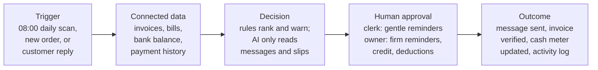

# Kutip

> A cash-collection assistant for Malaysian micro and small B2B sellers, built as a module for the Orbyte business hub: it warns the owner before payroll day runs short, holds new credit for customers who already pay late, and only marks an invoice paid when the money is in the bank.

**Never be surprised on payroll day, and stop giving credit to customers who don't pay.**

> SDC Hackathon 2026 (XMUM) · Domain 2: *Orbyte Smart SME Challenge — Less Busywork, Better Business* · sponsored by Alpha Red Solutions

---

## Team Information

| Field                  | Details                                     |
| ---------------------- | ------------------------------------------- |
| **Team Name**          | Taygood                                     |
| **Team Domain**        | Domain 2: Orbyte Smart SME Challenge        |
| **SDG Track (1–17)**   | SDG 8 — Decent Work and Economic Growth (targets 8.3 and 8.2) |
| **Team Leader**        | Hansen Yap Hong San                         |
| **University**         | Taylor's University                         |
| **Number of Members**  | ⚠️ TODO                                      |

## Links

| Resource          | Link                                           |
| ----------------- | ---------------------------------------------- |
| GitHub Repository | https://github.com/YapHongSanHansen/Xmum      |
| Live Demo         | Hosted on Vercel (team-confirmed; live URL to be added); local instructions in [How to Run](#how-to-run) |
| RunPod Endpoint   | Not used (see [How We Use RunPod](#how-we-use-runpod-required)) |
| Slide Deck        | ⚠️ TODO: slide deck link                        |
| Demo Video        | ⚠️ TODO: demo video link                        |

---

## Overview

### Problem

Small Malaysian businesses that sell to other businesses usually sell **on credit**. A haulage firm delivers three lorry-loads of tiles for a hardware wholesaler, and the wholesaler says *"I'll pay in 30 days."*

The wholesaler pays after 60 days, or 90. Meanwhile the haulier must pay **salary on the 31st**, plus rent and its own suppliers. The money it has earned is stuck in other people's pockets.

So the owner spends evenings on WhatsApp asking *"boss, can pay already?"*, and:

- finds out on payroll day that there isn't enough cash;
- keeps giving more goods on credit to the same customers who pay late;
- chases customers at random, from memory;
- matches "dah bank in" screenshots to the bank app by hand, and sometimes chases a customer who already paid.

SME payment delays in Malaysia average **64 days**, and **76 days** in transport and logistics ([Experian, 2025](https://www.experian.com.my/2025/05/21/experian-malaysias-state-of-credit-2025-reveals-sme-resilience-but-cash-flow-strains-persist/)).

### Solution

A customer can always choose not to pay, and no app can change that. So Kutip focuses on what the owner **can** control:

| | Feature | What it does |
|---|---|---|
| 1 | **Early warning** | Every morning it compares cash in the bank plus expected payments with the bills due soon. It warns the owner **10+ days before** a shortfall, while there is still time to act. |
| 2 | **Credit check** | When a customer who is already 30+ days late orders again on credit, Kutip holds the order until the owner decides: give credit, ask for a deposit, cash on delivery, or call first. |
| 3 | **Chase plan** | It ranks overdue invoices by how much each one closes the shortfall, and prepares WhatsApp reminders in the customer's language (BM, English, 中文). A clerk sends gentle ones; firm ones need the owner. |
| 4 | **Bukti** *(the AI part)* | AI reads customer replies and payment slips. The invoice is marked paid **only if the money is actually in the bank statement**. Anything unclear goes to a person. |

*Kutip* means "collect" in Malay. *Bukti* means "proof".

#### How it works



- **Rules make every decision**, and every decision shows the rule behind it.
- **AI is used in one place only**: reading messy replies like *"dah bank in boss"* or *"下礼拜五才过数"* ("can pay next Friday").
- **AI never decides anything about money.** Nothing is marked paid without a matching bank line.
- **People approve every consequential action**, and everything goes into an append-only activity log.

### Key Features

- **Early warning** — every morning it compares cash plus expected receipts with the bills due soon and warns the owner 10+ days before a shortfall, with a neutral checklist of the owner's own options.
- **Credit check** — a new credit order from a customer already 30+ days late is put on hold until the owner chooses: credit, deposit, cash on delivery, or call first.
- **Chase plan** — overdue invoices ranked by how much each one closes the next cash gap, each with its rule ID and reason, and fixed BM / English / 中文 WhatsApp templates that a person approves and sends.
- **Bukti (AI)** — Claude reads Manglish / BM / Chinese replies and payment slips into fields with the exact source words; a verbatim gate drops anything not quoted, and nothing is marked paid without a matching bank line.
- **People in control** — Owner and Clerk roles with different views and approval rights, a "Needs a human" hand-off queue, and an append-only activity log.

### Tech Stack

| Layer         | Technology                   |
| ------------- | ---------------------------- |
| Frontend      | Next.js 16 (App Router), React 19, TypeScript, Tailwind CSS 4, lucide-react |
| Backend       | Next.js route handler (`/api/extract`) for the AI call; rules engine in pure TypeScript (`web/src/engine`) |
| Database      | None in the preliminary build: Zustand store persisted to `localStorage`, reset from a synthetic seed (a hosted database is planned for the final round) |
| AI / Compute  | Claude Opus 5.5 (`claude-opus-5-5`) via the Anthropic API, structured JSON validated with Zod; cached results as fallback |
| Hosting / Dev | Vercel, GitHub, Vitest |

---

## See it in action

*All names and numbers are fictional.* The demo company is **Lori Laju Logistics**, a 12-person haulage firm in Klang with 6 lorries. Transport has the longest SME payment delays in Malaysia (76 days on average), and per-trip invoices mean many payment slips.

On Tuesday at 08:00, Kutip spots a salary shortfall 11 days ahead:

```text
┌────────────────────────────────────────────────────────────────────┐
│ EARLY WARNING · 31 Oct salaries                  Owner only        │
├────────────────────────────────────────────────────────────────────┤
│ Short RM2,000 in 11 days, if nobody else pays                      │
├────────────────────────────────────────────────────────────────────┤
│ YOUR OPTIONS (pick any, all logged)                      R6        │
│ [ ] Ask a regular customer to pay early                            │
│ [x] Ask the diesel supplier to move the 5 Nov bill                 │
│ [ ] Hold new credit for customers 30+ days late                    │
│ [ ] Talk to my bank myself (note only)                             │
├────────────────────────────────────────────────────────────────────┤
│ Kutip lists options only. It does not recommend a lender.          │
└────────────────────────────────────────────────────────────────────┘
```

On Wednesday, a customer who is already 46 days late books another lorry on credit:

```text
┌────────────────────────────────────────────────────────────────────┐
│ CREDIT CHECK · new booking · Syarikat Hup Seng Trading   R4        │
├────────────────────────────────────────────────────────────────────┤
│ New booking: Klang → Johor Bahru · 1 lorry · RM2,400 · 60 days     │
│ Already owes: INV-2268 RM6,850 · 46 days late                      │
│ Promised: pay on Fri 30 Oct                                        │
│ Total owed if accepted: RM9,250                                    │
├────────────────────────────────────────────────────────────────────┤
│ [ Accept on credit ]  [ Ask 50% deposit ]  [ Cash on delivery ]    │
└────────────────────────────────────────────────────────────────────┘
```

On Friday, a customer says they've paid, with a deduction. Bukti reads the message and the slip, then checks the bank before anything is marked paid:

```text
┌────────────────────────────────────────────────────────────────────┐
│ BUKTI · Mega Bina Hardware Trading         Fri 23 Oct 14:30        │
├────────────────────────────────────────────────────────────────────┤
│ "Hi kak, payment for INV-2304 done ya. Bank in RM2,770 just        │
│  now, deduct RM330 for the 2 pallet tiles pecah at Bukit Raja.     │
│  Slip attached"                                 + slip.png         │
├────────────────────────────────────────────────────────────────────┤
│ AI READ (exact words shown for every field)                        │
│ Amount     RM2,770.00   "RM2,770"                      98%         │
│ Invoice    INV-2304     "INV-2304"                     97%         │
│ Deduction  RM330.00     "deduct RM330 for the 2 pallet…"  90%      │
├────────────────────────────────────────────────────────────────────┤
│ BANK CHECK  M1     23/10 DUITNOW CR 2,770.00 MEGA BINA   ✓         │
│ DEDUCTION   M3     linked to DO-8812 · Shah Alam → Bukit Raja      │
├────────────────────────────────────────────────────────────────────┤
│ Clerk: approve receipt RM2,770 · Owner: accept or reject RM330     │
└────────────────────────────────────────────────────────────────────┘
```

The full script is in [`docs/PRD.md`](docs/PRD.md#13-preliminary-demo-script-about-3-4-minutes), and every expected log line is in section 13a.

## Why Kutip is different

Payment-reminder tools already exist: [Paidnice](https://www.paidnice.com/features) and [Peakflo](https://peakflo.co/whatsapp-ai-agents) abroad, and Bukku, SQL Account and AutoCount locally. They are built around *chasing*, and are aimed at bigger firms or users of particular accounting software.

| | Typical reminder tools | Kutip |
|---|---|---|
| Promise | "Chase customers automatically" | "No surprises on payroll day" |
| Ranks who to chase by the next cash shortfall | Not found | ✓ |
| Holds new credit for late payers, tied to the cash gap | In some accounting software | ✓ for sellers whose orders arrive on WhatsApp |
| Checks a WhatsApp payment slip against the bank before marking paid | Enterprise tools only | ✓ for micro firms |
| Manglish / BM / 中文 replies | Generic "any language" claims | Designed and tested for it |
| Price | About RM300+/month, or quote-only, for WhatsApp + AI | Aiming for less than RM65/month |

Details and sources are in [`docs/research/02-competitor-scan.md`](docs/research/02-competitor-scan.md).

## Built for Orbyte

Orbyte is a shared business hub for SMEs. Kutip is designed as a module inside it, not a standalone app:

- **Data in** through Orbyte Connect, from accounting partners (or a CSV).
- **Reuses Orbyte's platform**: client records, roles, review-and-approval flows and the audit trail.
- **Adds something new.** Orbyte covers HR and admin (leave, claims, overtime, attendance, hiring); Kutip adds finance and sales.
- **Fits Orbyte's credit wallet**, paying per invoice chased and per slip read.
- **Reusable across many businesses**, with packs for printing, catering supply, wholesale and transport.

## People stay in control

| Role | Can do |
|---|---|
| **Owner** | Sees everything; decides credit checks; approves firm reminders and anything that changes what a customer owes |
| **Clerk** | Sends gentle reminders, approves exact payment matches, answers hand-off questions; never sees the bank balance or payroll |
| **Sales** *(planned)* | Sees whether a customer is on hold |
| **Accountant** *(planned)* | Read-only export of the aging report and activity log |

**Out of scope, by design:** Kutip does not process payments, submit e-invoices or tax filings, or give legal or financial advice. It never recommends a lender. The demo uses synthetic data only, and PDPA handling for a real deployment is described in the docs.

---

## Project Structure

```
.
├── docs/
│   ├── PRD.md                   # Build spec: requirements, rules, demo script, expected log
│   ├── idea/kutip-bukti.md      # The full idea and example screens
│   ├── domain-2/                # Hackathon brief (PDF + text)
│   └── research/                # Pain research, competitor scan, raw data
├── submission/                  # Required submission documents
│   ├── SDC2026_Taygood_Preliminary.pdf      # Preliminary submission
│   ├── SDC2026_Taygood_TechDeclaration.pdf  # Technology declaration
│   ├── SDC2026_Taygood_Replit_POU.pdf       # Replit proof of use (statement: not used)
│   ├── SDC2026_Taygood_Runpod_POU.pdf       # RunPod proof of use (statement: not used)
│   ├── answers.md               # Source text of every answer (edit here, then rebuild)
│   ├── build_pdfs.py            # Writes answers.md into the official templates
│   └── templates/               # Blank official templates (input to build_pdfs.py)
├── web/                         # The Kutip app (Next.js)
│   ├── src/app/                 # Page and the /api/extract route (AI call)
│   ├── src/components/          # Orbyte hub shell, Today, Bookings, Bukti inbox, log
│   ├── src/engine/              # Rules engine, synthetic seed, tests (Vitest)
│   ├── src/lib/                 # Store and AI client/server helpers
│   └── .env.example             # Example environment variables
├── LICENSE
└── README.md
```

### Architecture

```
Browser ── Next.js app (Orbyte hub frame, Owner/Clerk views)
   │          │
   │          ├─► Rules engine (TypeScript): cash forecast, credit check, chase plan,
   │          │   verbatim gate, bank match, approvals ─► append-only activity log
   │          │
   │          └─► POST /api/extract (Next.js server route) ──► Anthropic API (Claude Opus 5.5)
   │                     │   reads one reply + slip → Zod-validated fields with quotes
   │                     └── on error or timeout: cached extraction ("cached result")
   │
   └── Synthetic data only: seed invoices, bank CSV lines, messages, slips
```

AI only reads messages. Every decision (what to chase, whether something is paid, who may approve) is a deterministic rule with an ID shown in the UI.

---

## How to Run

### Option 1 — Open the live demo (once deployed)

1. Open the Vercel Live Demo link above once the deployment URL is added. Nothing to install.
2. Use the role switcher in the header to act as **Owner** (Lim Siew Lan) or **Clerk** (Nurul).
3. Follow the demo script in [`docs/PRD.md`](docs/PRD.md#13-preliminary-demo-script-about-3-4-minutes). **Reset demo** in the header starts it again.

### Option 2 — Run Locally

Requires Node.js 20+ and pnpm 10 (`corepack pnpm` works if pnpm is not installed).

```bash
# 1. Clone the repository
git clone https://github.com/YapHongSanHansen/Xmum.git
cd Xmum/web

# 2. Install dependencies
pnpm install

# 3. (Optional) Configure the AI key
cp .env.example .env.local      # then set ANTHROPIC_API_KEY

# 4. Run the app
pnpm dev                        # http://localhost:3000
```

Without `ANTHROPIC_API_KEY`, Bukti uses saved results for the three demo messages and labels them "cached result". Everything else runs locally with no network.

### Run Tests

```bash
cd web
pnpm test        # rules engine: every seed check and the full demo script
```

---

## How We Use Replit *(Required)*

**We did not use Replit for this project.** We declare this rather than add a token integration (Handbook 8.1.3 and 8.4).

- **Development:** code was written locally and shared through this GitHub repository.
- **Hosting:** Vercel, as confirmed by the team. The live deployment URL still needs to be added above.
- **Secrets:** the only key, `ANTHROPIC_API_KEY`, is stored as an environment variable on the host and in a local `.env.local` that git ignores. No secrets are in this repository.

📄 Proof of use: [`submission/SDC2026_Taygood_Replit_POU.pdf`](submission/SDC2026_Taygood_Replit_POU.pdf) (a signed statement that Replit was not used)

## How We Use RunPod *(Required)*

**We did not use RunPod for this project.**

- **Workload:** Kutip's only AI step reads one short message and one slip image per customer reply. It calls a hosted model (Claude Opus 5.5 through the Anthropic API) rather than running a GPU model.
- **Why not self-host:** the step is small and infrequent, and a hosted API gave us vision input and structured output on day one. The rules engine needs no GPU.
- **Where it would fit:** in a real deployment, Malaysian data-residency preferences (PDPA cross-border transfer) could justify an open-weight vision model on a GPU endpoint such as RunPod Serverless. The `/api/extract` route is the single place that would change.

📄 Proof of use: [`submission/SDC2026_Taygood_Runpod_POU.pdf`](submission/SDC2026_Taygood_Runpod_POU.pdf) (a signed statement that RunPod was not used)

---

## Tools and AI declaration

Declared under handbook section 8.4.

| Used for | Tool |
|---|---|
| App | Next.js 16, React 19, TypeScript, Tailwind CSS 4, Zustand, Zod, lucide-react |
| Tests | Vitest |
| AI inside the product | Claude Opus 5.5 (Anthropic API) reads customer replies and payment slips (Bukti). Rules, not AI, make every decision |
| Hosting | Vercel |
| AI tools used to build | Claude Code (Anthropic) for research, documentation and code generation, reviewed and adapted by the team |
| Data | Synthetic only: every business, person, bank, slip and message is fictional. No pre-existing project code is used |

Full declaration: [`submission/SDC2026_Taygood_TechDeclaration.pdf`](submission/SDC2026_Taygood_TechDeclaration.pdf).

## Status

| | |
|---|---|
| ✅ | Problem research, competitor scan, idea brief, PRD (v0.2) |
| ✅ | Rules engine (`web/src/engine`) running the full demo script in tests |
| 🔄 | Web app: Orbyte hub frame, Today, Bookings, Bukti inbox, activity log |
| ⬜ | Interviews with 5-10 Malaysian B2B sellers |

## Challenges & Learnings

- **Keeping AI away from money decisions.** It was tempting to let the model decide "paid / not paid". Instead the model only extracts fields, each field must quote the customer's exact words (the verbatim gate), and a deterministic rule marks something paid only when a bank line matches. A wrong AI reading therefore leads to a hand-off question, not a wrong record.
- **A promise we can keep.** No app can make a customer pay. We reframed the product around what the owner controls (early warning, the credit decision, who to chase, correct records), so its value doesn't depend on customers changing their behaviour.
- **A demo that can be repeated.** A frozen demo clock, a synthetic seed and an expected activity log (PRD section 13a) let the full journey run the same way every time, and the test suite replays the whole script.
- **Mixed-language replies.** Messages like "下礼拜五才过数" ("pay next Friday") are ambiguous about the date. We learned to hand such cases to a person with one specific question instead of guessing.
- **What we learned:** rules with visible IDs make the product easier to trust and to explain than an AI answer, and a small, clear AI step is easier to make reliable than a chatbot.

## Future Improvements

- [ ] Interview 5-10 Malaysian B2B sellers to validate slip usage, chasing time and the credit-check habit
- [ ] Hosted database and server-side rules engine (Convex or Postgres), replacing the browser store
- [ ] Multi-invoice payment allocation, Sales and Accountant roles, CSV export of the aging report and log
- [ ] Accuracy report on a 30-50 message Manglish / BM / Chinese test set (target ≥ 95% exact amount)
- [ ] Orbyte Connect adapter for accounting partners; official WhatsApp Business Platform; bank feeds
- [ ] Sector packs (transport, printing, wholesale, catering supply) and a BM user interface

## Team

| Name        | Role                | GitHub                                   |
| ----------- | ------------------- | ---------------------------------------- |
| Hansen Yap Hong San | Team Lead (⚠️ TODO: role) | [@YapHongSanHansen](https://github.com/YapHongSanHansen) |
| ⚠️ TODO: name | ⚠️ TODO: role | [@Ckayz](https://github.com/Ckayz) |
| ⚠️ TODO: name | ⚠️ TODO: role | ⚠️ TODO |

## Docs

| Read this | For |
|---|---|
| [`docs/PRD.md`](docs/PRD.md) | **What to build:** goals, user stories, functional requirements with acceptance criteria, business rules, data model, permissions, demo script and expected log, synthetic data spec, Domain 2 traceability |
| [`docs/idea/kutip-bukti.md`](docs/idea/kutip-bukti.md) | The full idea: example screens, rules, roles, requirement mapping, risks, demo scope |
| [`docs/domain-2/brief.md`](docs/domain-2/brief.md) | The hackathon brief as text (source of truth: [`Domain-2-brief.pdf`](docs/domain-2/Domain-2-brief.pdf)) |
| [`docs/research/01-pain-research-shortlist.md`](docs/research/01-pain-research-shortlist.md) | How the idea was chosen: researched pains, evidence, shortlist, judge scores |
| [`docs/research/02-competitor-scan.md`](docs/research/02-competitor-scan.md) | What already exists, and the gap |
| [`docs/research/data/`](docs/research/data/) | Raw JSON from the research runs |

**For AI agents:** read the brief first, then the PRD (the build spec), then the idea brief and the research. Where the PRD and the idea brief differ on rules or numbers, the PRD wins. The PDF is the source of truth for requirements. Research notes came from multi-agent runs and were spot-checked by hand; corrections are marked in place. Re-verify any figure before it goes into the pitch.

---

## Submission Checklist

- [x] Team name, domain (Domain 1 / Domain 2) and SDG track filled in
- [ ] Slide deck link added
- [ ] Demo video link added
- [x] Replit use declared (not used), with a statement in `submission/`
- [x] RunPod use declared (not used), with a statement in `submission/`
- [ ] Preliminary submission completed (`SDC2026_Taygood_Preliminary.pdf`) *(drafted; phone, member count, workshops, IP-conflict answer and signature TODO)*
- [ ] Technology declaration completed (`SDC2026_Taygood_TechDeclaration.pdf`) *(drafted; phone, live URL and signature TODO)*
- [x] Submission files renamed with your team name (replace `TeamName`)
- [x] "How to Run" steps verified
- [x] No API keys or secrets committed to the repository

## License

This project is licensed under the [Apache License 2.0](LICENSE).
