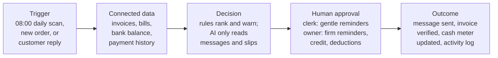

# Kutip

**Never be surprised on payroll day, and stop giving credit to customers who don't pay.**

Kutip is a cash-collection assistant for Malaysian micro and small businesses, built for the Orbyte business hub. It warns the owner before cash runs short, stops new credit to customers who already pay late, tells the team who to chase first, and uses AI to check customers' "dah bank in boss" messages against the bank statement.

> XMUM Hackathon · Domain 2: *Orbyte Smart SME Challenge — Less Busywork, Better Business* · sponsored by Alpha Red

---

## The problem

Small Malaysian businesses that sell to other businesses usually sell **on credit**. A printing shop delivers 500 cake boxes to a café, and the café says *"I'll pay in 30 days."*

The café pays after 60 days, or 90. Meanwhile the shop must pay **salary on the 31st**, plus rent and its own suppliers. The money it has earned is stuck in other people's pockets.

So the owner spends evenings on WhatsApp asking *"boss, can pay already?"*, and:

- finds out on payroll day that there isn't enough cash;
- keeps giving more goods on credit to the same customers who pay late;
- chases customers at random, from memory;
- matches "dah bank in" screenshots to the bank app by hand, and sometimes chases a customer who already paid.

SME payment delays in Malaysia average **64 days**, and **76 days** in transport and logistics ([Experian, 2025](https://www.experian.com.my/2025/05/21/experian-malaysias-state-of-credit-2025-reveals-sme-resilience-but-cash-flow-strains-persist/)).

## The idea

A customer can always choose not to pay, and no app can change that. So Kutip focuses on what the owner **can** control:

| | Feature | What it does |
|---|---|---|
| 1 | **Early warning** | Every morning it compares cash in the bank plus expected payments with the bills due soon. It warns the owner **10+ days before** a shortfall, while there is still time to act. |
| 2 | **Credit check** | When a customer who is already 30+ days late orders again on credit, Kutip holds the order until the owner decides: give credit, ask for a deposit, cash on delivery, or call first. |
| 3 | **Chase plan** | It ranks overdue invoices by how much each one closes the shortfall, and prepares WhatsApp reminders in the customer's language (BM, English, 中文). A clerk sends gentle ones; firm ones need the owner. |
| 4 | **Bukti** *(the AI part)* | AI reads customer replies and payment slips. The invoice is marked paid **only if the money is actually in the bank statement**. Anything unclear goes to a person. |

*Kutip* means "collect" in Malay. *Bukti* means "proof".

## How it works



- **Rules make every decision**, and every decision shows the rule behind it.
- **AI is used in one place only**: reading messy replies like *"dah bank in boss"* or *"下礼拜五才过数"* ("can pay next Friday").
- **AI never decides anything about money.** Nothing is marked paid without a matching bank line.
- **People approve every consequential action**, and everything goes into an append-only activity log.

## See it in action

*All names and numbers are fictional.* CetakPantas Print is a 4-person printing shop. On Tuesday morning, Kutip spots a problem 11 days ahead:

```text
┌────────────────────────────────────────────────────────────────────┐
│ EARLY WARNING · payroll 31 Oct                   Owner only        │
├────────────────────────────────────────────────────────────────────┤
│ Short RM2,000 in 11 days, if nobody else pays                      │
│ Chase plan sent: Kafe Dua Beradik RM3,180 (usually pays fast)      │
├────────────────────────────────────────────────────────────────────┤
│ YOUR OPTIONS (pick any, all logged)                                │
│ [ ] Ask a regular customer to pay early                            │
│ [ ] Ask paper supplier to move 5 Nov bill to 15 Nov                │
│ [ ] Hold new credit for customers 30+ days late                    │
│ [ ] Note: talk to my bank myself                                   │
└────────────────────────────────────────────────────────────────────┘
```

On Wednesday, a customer who is 42 days late orders more boxes on credit:

```text
┌────────────────────────────────────────────────────────────────────┐
│ CREDIT CHECK · new order · Hock Lee Catering      Owner only       │
├────────────────────────────────────────────────────────────────────┤
│ New order: 300 food boxes · RM2,850 · on 60-day credit             │
│ Already owes: INV-0398 RM4,750 · 42 days late                      │
│ Promised (20 Oct reply): pay on Fri 30 Oct                         │
│ Total owed if accepted: RM7,600                                    │
├────────────────────────────────────────────────────────────────────┤
│ [ Accept on credit ]  [ Ask 50% deposit ]  [ Cash on delivery ]    │
└────────────────────────────────────────────────────────────────────┘
```

On Friday, another customer says they've paid. Bukti reads the message and checks the bank before anything is marked paid:

```text
┌────────────────────────────────────────────────────────────────────┐
│ BUKTI · new reply · Kafe Dua Beradik          Fri 23 Oct 14:30     │
├────────────────────────────────────────────────────────────────────┤
│ "Dah bank in boss, RM3,180 for the cake box invoice ya.            │
│  Slip attached"                              + slip.jpg            │
├────────────────────────────────────────────────────────────────────┤
│ AI READ (exact words shown for every field)                        │
│ Amount     RM3,180.00    "RM3,180"           98%                   │
│ Invoice    INV-0412      "cake box invoice"  91%                   │
├────────────────────────────────────────────────────────────────────┤
│ BANK CHECK                                                         │
│ 23/10 DUITNOW CR 3,180.00 KAFE DUA BERADIK INV0412   ✓ match       │
├────────────────────────────────────────────────────────────────────┤
│ Proposed: INV-0412 → PAID · reminders stop                         │
└────────────────────────────────────────────────────────────────────┘
```

The full walkthrough, including the chase plan, approvals, hand-offs and activity log, is in [`docs/idea/kutip-bukti.md`](docs/idea/kutip-bukti.md#5-example-flow-all-names-and-numbers-fictional).

## Why Kutip is different

Payment-reminder tools already exist: [Paidnice](https://www.paidnice.com/features) and [Peakflo](https://peakflo.co/whatsapp-ai-agents) abroad, and Bukku, SQL Account and AutoCount locally. They are built around *chasing*, and are aimed at bigger firms or users of particular accounting software.

| | Typical reminder tools | Kutip |
|---|---|---|
| Promise | "Chase customers automatically" | "No surprises on payroll day" |
| Ranks who to chase by the next cash shortfall | Not found | ✓ |
| Holds new credit for late payers, tied to the cash gap | In some accounting software | ✓ for sellers whose orders arrive on WhatsApp |
| Checks a WhatsApp payment slip against the bank before marking paid | Enterprise tools only | ✓ for micro firms |
| Manglish / BM / 中文 replies | Generic "any language" claims | Designed and tested for it |
| Price | About RM300+/month, or quote-only, for WhatsApp + AI | Aiming for less than RM65/month |

Details and sources are in [`docs/research/02-competitor-scan.md`](docs/research/02-competitor-scan.md).

## Built for Orbyte

Orbyte is a shared business hub for SMEs. Kutip is designed as a module inside it, not a standalone app:

- **Data in** through Orbyte Connect, from accounting partners (or a CSV).
- **Reuses Orbyte's platform**: client records, roles, review-and-approval flows and the audit trail.
- **Adds something new.** Orbyte covers HR and admin (leave, claims, overtime, attendance, hiring); Kutip adds finance and sales.
- **Fits Orbyte's credit wallet**, paying per invoice chased and per slip read.
- **Reusable across many businesses**, with packs for printing, catering supply, wholesale and transport.

## People stay in control

| Role | Can do |
|---|---|
| **Owner** | Sees everything; decides credit checks; approves firm reminders and anything that changes what a customer owes |
| **Clerk** | Sends gentle reminders, approves exact payment matches, answers hand-off questions; never sees the bank balance or payroll |
| **Sales** *(planned)* | Sees whether a customer is on hold |
| **Accountant** *(planned)* | Read-only export of the aging report and activity log |

**Out of scope, by design:** Kutip does not process payments, submit e-invoices or tax filings, or give legal or financial advice. It never recommends a lender. The demo uses synthetic data only, and PDPA handling for a real deployment is described in the docs.

## Status

| | |
|---|---|
| ✅ | Problem research, competitor scan, idea brief |
| ✅ | Product requirements document (draft v0.1, reviewed once by a builder) |
| ⬜ | Team decisions: stack, LLM, demo sector, deadline (see PRD section 18) |
| ⬜ | Preliminary-round MVP: the full journey running live on synthetic data |
| ⬜ | Interviews with 5-10 Malaysian B2B sellers |

## Docs

| Read this | For |
|---|---|
| [`docs/PRD.md`](docs/PRD.md) | **What to build:** goals, user stories, functional requirements with acceptance criteria, business rules, data model, permissions, demo script and expected log, synthetic data spec, Domain 2 traceability |
| [`docs/idea/kutip-bukti.md`](docs/idea/kutip-bukti.md) | The full idea: example screens, rules, roles, requirement mapping, risks, demo scope |
| [`docs/domain-2/brief.md`](docs/domain-2/brief.md) | The hackathon brief as text (source of truth: [`Domain-2-brief.pdf`](docs/domain-2/Domain-2-brief.pdf)) |
| [`docs/research/01-pain-research-shortlist.md`](docs/research/01-pain-research-shortlist.md) | How the idea was chosen: researched pains, evidence, shortlist, judge scores |
| [`docs/research/02-competitor-scan.md`](docs/research/02-competitor-scan.md) | What already exists, and the gap |
| [`docs/research/data/`](docs/research/data/) | Raw JSON from the research runs |

**For AI agents:** read the brief first, then the PRD (the build spec), then the idea brief and the research. Where the PRD and the idea brief differ on rules or numbers, the PRD wins. The PDF is the source of truth for requirements. Research notes came from multi-agent runs and were spot-checked by hand; corrections are marked in place. Re-verify any figure before it goes into the pitch.
